# gpui-bootstrap

Bootstrap 5 components for [GPUI](https://gpui.rs), built on
[gpui-kit](https://gpui-kit.com).

Behavior (focus, keyboard activation, accessibility, modal focus trapping)
comes from gpui-kit's unstyled `gpui_kit::base` controls. This crate supplies
Bootstrap 5.3's look through one token `Theme` that every component reads at
render time, so re-theming is a matter of changing a few values.

| Light | Dark |
| --- | --- |
| 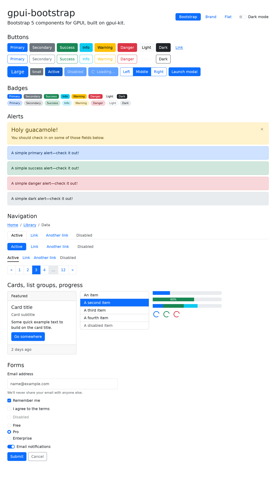 | 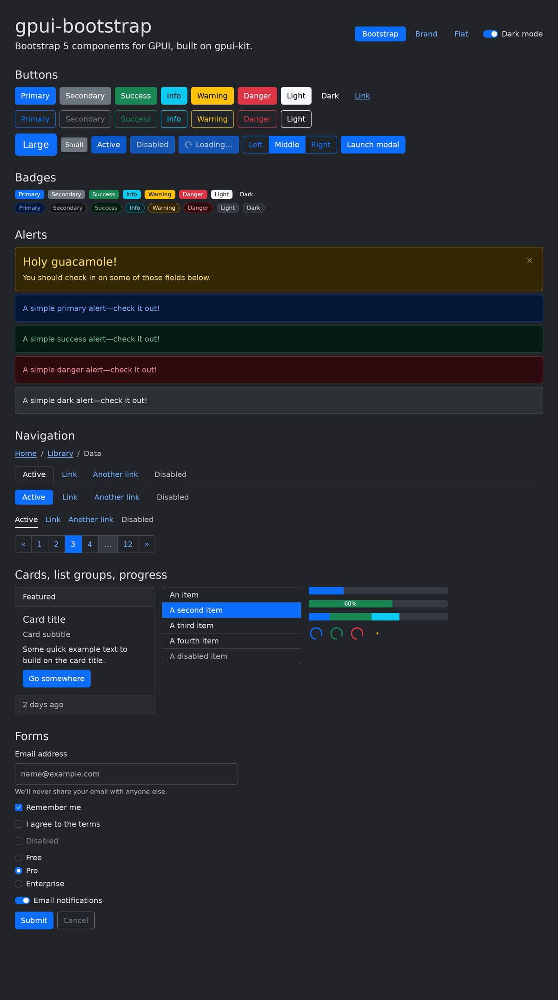 |
| **Re-themed: brand colors and radii** | **Re-themed: flat, compact, dark** |
| 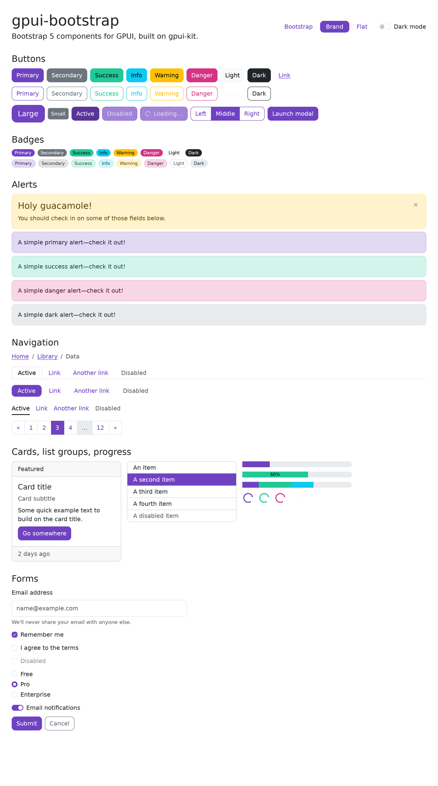 | 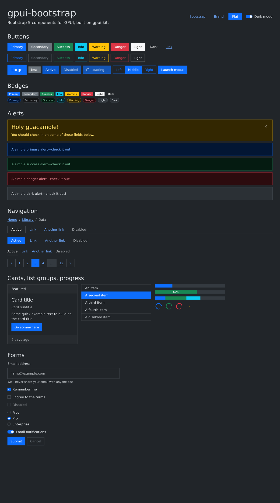 |

## Components

| Bootstrap | gpui-bootstrap |
| --- | --- |
| `.btn`, `.btn-outline-*`, `.btn-link`, `.btn-group` | `Button`, `ButtonGroup` |
| `.btn-close` | `CloseButton` |
| `.badge` | `Badge` |
| `.alert` (dismissible) | `Alert` |
| `.card` | `Card` |
| `.list-group` | `ListGroup`, `ListGroupItem` |
| `.progress`, `.progress-stacked` | `Progress`, `ProgressBar` |
| `.spinner-border`, `.spinner-grow` | `Spinner` |
| `.breadcrumb` | `Breadcrumb` |
| `.nav`, `.nav-tabs`, `.nav-pills`, `.nav-underline` | `Nav`, `NavItem` |
| `.pagination` | `Pagination` |
| `.modal` | `Modal` |
| `.form-control`, `.form-label`, `.form-text` | `FormControl`, `FormLabel`, `FormText` |
| `.form-check` (checkbox, radio, switch) | `Checkbox`, `Radio`, `Switch` |
| Headings, `.lead`, `.text-body-secondary` | `Heading`, `Lead`, `Muted`, `body` |

Every component takes a `Variant` (`Primary`, `Secondary`, `Success`, `Info`,
`Warning`, `Danger`, `Light`, `Dark`) where Bootstrap does, and controls take
`Size::Small` / `Size::Large` for `-sm` / `-lg`.

## Usage

```toml
[dependencies]
gpui-kit = "=0.7.3"
gpui-bootstrap = { git = "https://github.com/Ziinc/gpui-bootstrap" }
```

gpui-kit pins its `gpui-pre` snapshot and re-exports GPUI, so you never list
GPUI yourself. gpui-bootstrap tracks the same gpui-kit version.

```rust
use gpui_bootstrap::prelude::*;
use gpui_kit::*;

struct App;

impl Render for App {
    fn render(&mut self, _: &mut Window, cx: &mut Context<Self>) -> impl IntoElement {
        body(cx).p_4().gap_2().flex().child(
            Button::new("save")
                .label("Save")
                .on_click(|_, _, _| println!("saved")),
        )
        .child(Badge::new("New").variant(Variant::Success).pill(true))
    }
}

fn main() {
    gpui_kit::application()
        .with_assets(gpui_kit::assets::Assets) // icons for close, check, spinner
        .run(|cx| {
            gpui_bootstrap::init(cx);
            gpui_kit::open_window(WindowOptions::default(), cx, |_, cx| cx.new(|_| App))
                .unwrap();
        });
}
```

## Platform themes

Built-in themes match each platform GPUI targets, in light and dark. They keep
Bootstrap's components and swap in the platform's system palette, type scale,
corner radii and control sizes (44pt touch targets on iOS, 40dp pill buttons on
Android).

```rust
use gpui_bootstrap::{ColorMode, Platform, Theme};

// Whatever OS the app runs on, following the window's appearance.
Theme::native(ColorMode::from(window.appearance())).apply(cx);

// Or a specific platform, overridden like any other theme.
let mut theme = Theme::platform(Platform::Android, ColorMode::Dark);
theme.colors.primary = rgb(0x006a6a).into();
theme.apply(cx);
```

| `Platform` | Follows |
| --- | --- |
| `Web` (default) | Bootstrap 5.3 as shipped |
| `MacOS` | Apple HIG, macOS system colors, 13pt type |
| `Windows` | Fluent 2 / WinUI 3, 32px controls |
| `Linux` | GNOME libadwaita |
| `IOS` | Apple HIG, iOS system colors, 17pt type, 44pt targets |
| `Android` | Material 3 baseline scheme |

`Theme::change_mode` / `with_mode` follow the platform's palette for the new
mode and keep any theme color you overrode.

| macOS | Windows | Linux (GNOME) |
| --- | --- | --- |
| 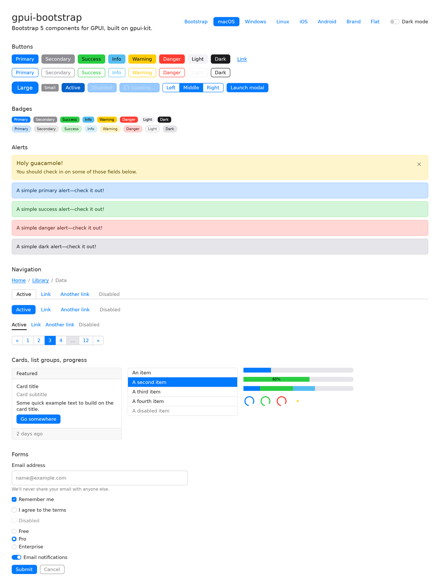 | 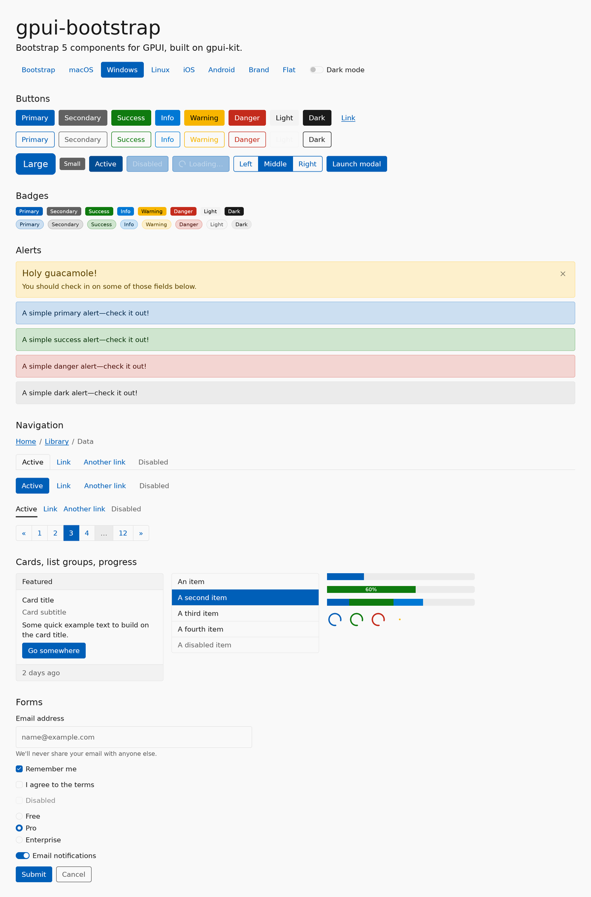 | 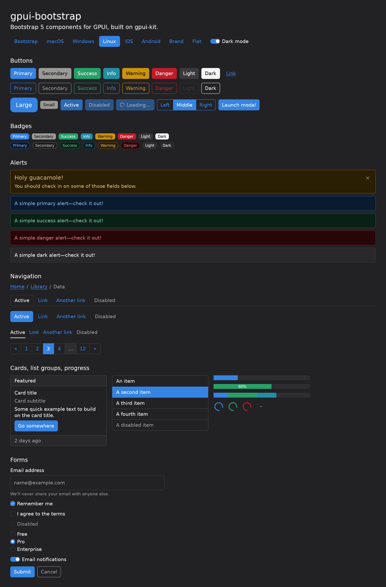 |

| iOS | iOS dark | Android | Android dark |
| --- | --- | --- | --- |
| 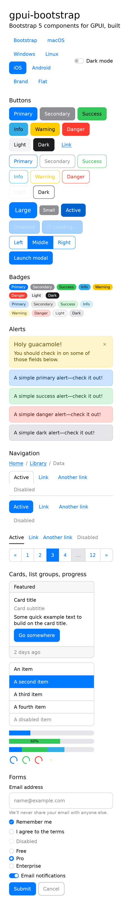 | 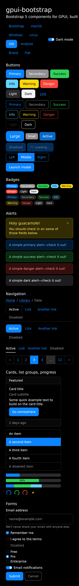 | 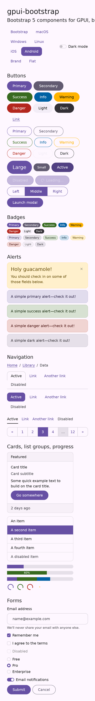 | 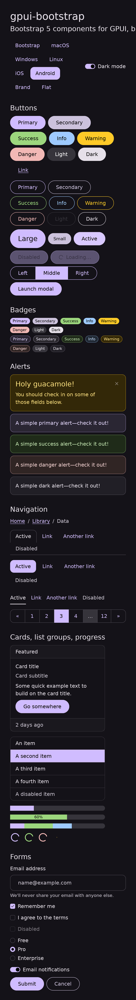 |

## Theming

`Theme` mirrors Bootstrap's Sass variables. Its fields are public: change the
ones you want and keep the rest. Hover, active and focus colors, the subtle
backgrounds of alerts and badges, emphasis text, and the text color that reads
on each fill are derived from the eight theme colors exactly as Bootstrap's
`tint-color()`, `shade-color()` and `color-contrast()` do, so overriding
`primary` re-themes every primary button, alert, link, checkbox and focus ring.

```rust
use gpui_bootstrap::{ColorMode, Theme};

// Start from a preset and override tokens.
let mut theme = Theme::light();
theme.colors.primary = rgb(0x6f42c1).into();
theme.radius.base = px(10.);
theme.typography.font_size_base = px(14.);
theme.apply(cx);

// Or edit the installed theme in place.
Theme::update(cx, |theme| theme.colors.danger = rgb(0xd63384).into());

// Switch color mode, keeping the theme colors.
Theme::change_mode(ColorMode::Dark, cx);
```

| Token group | Fields |
| --- | --- |
| `colors` | the eight theme colors, `white`, `black`, `body_bg`, `body_color`, `emphasis_color`, `secondary_*`, `tertiary_*`, `border_color`, `border_color_translucent`, `link_color`, `link_hover_color`, `backdrop` |
| `radius` | `sm`, `base`, `lg`, `xl`, `xxl`, `pill` |
| `typography` | font families, `font_size_base/sm/lg`, `line_height`, weights, `headings` |
| `controls` | `small`/`medium`/`large` padding and `min_height`, `button_radius` |
| scalars | `spacer` (spacing scale via `theme.spacing(0..=5)`), `border_width`, `focus_ring_width`, `focus_ring_opacity`, `disabled_opacity`, `min_contrast_ratio` |

`Theme::apply` also maps the tokens onto gpui-kit's own component theme, so
the text editor inside `FormControl`, scrollbars, and any gpui-kit component
you mix in follow the same colors and mode.

Read the active theme in your own components with `cx.theme()` (trait
`gpui_bootstrap::ActiveTheme`), and use `theme.variant(v)` /
`theme.button(v)` for the derived colors.

## Documentation

The [styleguide](https://ziinc.github.io/gpui-bootstrap/) runs every component
in the browser, with knobs for its builders, a theme picker for each platform
in light and dark, and copyable code. The
[API docs](https://ziinc.github.io/gpui-bootstrap/api/gpui_bootstrap/) embed
rendered previews of the same examples. Both are built with
[gpui-styleguidist](https://github.com/Ziinc/gpui-styleguidist) and published
to GitHub Pages from `main`.

```sh
cargo run --example styleguide            # the styleguide in a native window
cargo run --example styleguide -- render  # re-render styleguide/ after a visual change
cargo run --example styleguide -- check   # what CI runs: fails on pixel changes
cargo doc --open --features styleguide    # API docs with previews

# The web build (needs nightly with wasm32-unknown-unknown and the
# wasm-bindgen-cli version in Cargo.lock):
cargo install cargo-styleguide --git https://github.com/Ziinc/gpui-styleguidist
cargo styleguide serve
```

Examples live in [`examples/styleguide.rs`](examples/styleguide.rs). Snapshots
cover stock Bootstrap light and dark; the live styleguide offers every theme.

## Gallery

```sh
cargo run --example gallery
# Headless PNG (Linux needs Vulkan, e.g. mesa-vulkan-drivers):
cargo run --example gallery -- --screenshot out.png --dark --theme android
```

## License

MIT
